# Canonical story: question → relation → next question

Generated from `research/tools/canonical_story_source.py` (`research/canonical_story.json`). Do not edit by hand. Decisions: `docs/restructure_decisions.md`, "Canonical story diagnostic" and "Act VIII final lock: story fidelity".

**The canonical story is the 20-node Master Map** (`docs/Interactive_Master_Map.extracted.md`), read as a directed relation graph: a numbered adjacency is not automatically a NEXT QUESTION edge. Question → mathematical relation discovered → next question created by that relation. No theorem-first ordering.

**Foundation Spine: ABSTRACT STRUCTURAL SUMMARY OF THE CANONICAL STORY.** The canonical story answers *How did Nadia's questions lead from one mathematical relation to the next?* The spine answers *What general structural categories became visible after that investigation?* The spine does not govern chronological order; the Master Story does.

Sources used: docs/Interactive_Master_Map.extracted.md (the original Master Map, "Recovered topic map from the Paper Structure Review discussion": 20 topics, scene descriptions, "What carries forward", and its own list of next questions); docs/claude_code_prompt.md §1–1b (H1–H3 in Nadia's words; f̂(n) = ⟨f, e_n⟩); docs/gate2_answers.md (answers 1–9); docs/restructure_decisions.md (backbone statements, R1–R19, D1–D13, Pair A / Pair B, model-manifold story, Act VIII decisions, the canonical-story and lock decisions); docs/restructure_report_rev3.md (AMB register), docs/act_map.md (teaching order).

*Not available:* The project conversations "Refine ThermaLens Thesis", "Paper Structure Review", "Explain Translation Invariance" and "Sustainability Essay Outline" are not in this repository and could not be opened here. The Master Map preserves the Paper Structure Review sequence; the Chain A questions are Nadia's recollection, recorded verbatim in the 2026-11-16 decisions.

## A. Three corrections (lock pass, 2026-11-17)

- **Correction A — zero frequency is not a zero-valued relation.** The zero chapter (#13) keeps four different usages of zero apart: zero object/value, zero relation, zero index/frequency, null/balance/cancellation. k = 0 is the zero-frequency (DC) coordinate or mode, a zero in the index/coordinate domain; f̂(k) = 0 is a zero projection value and ⟨x, y⟩ = 0 a zero relation. Zero frequency stays in #13; it is moved out of the zero-value taxonomy table into its own category. (Where: research/master_math_map.md Part IV ("Kinds of zero"); this file: ZERO_KINDS, node M13, chain Z, F7.)
- **Correction B — #15/#16 → #19 is a cross-reference, not a causal edge.** The historical edge to relativity is #18 → #19 (NEXT QUESTION). #15/#16 ⇢ #18/#19 is a CROSS-REFERENCE: an earlier mathematical-space question was later reused when thinking about time/spacetime. It does not mean model manifolds and spacetime are the same structure, and it does not mean model-manifold theory generated relativity historically. (Where: EDGES (M15/M16 ⇢ M18, M19); alignment D12, D39; Act VIII placement (c → ∞); research/master_math_map.md Part IX.)
- **Correction C — the story is a graph, not forced adjacency.** Five edge types (NEXT QUESTION, EARLIER PREDECESSOR, CROSS-REFERENCE, APPLICATION HANDOFF, OPEN / NO DIRECT CAUSAL EDGE). Four consecutive pairs carry no causal edge: #9 → #10, #12 → #13, #16 → #17, #17 → #18. #12 → #17 (Fourier pairs → physical pairs) is kept as an EARLIER PREDECESSOR; no strong #16 → #17 transition is invented. (Where: EDGES; the 20-node story table.)

### Kinds of zero (Master Map #13)

| Kind | Examples | Meaning |
|---|---|---|
| zero object / value | the zero vector: ‖x‖ = 0 ⟺ x = 0 (Z10) — "a zero-length vector" (MM #13) | the object or measured value itself is zero |
| zero relation | ⟨x, y⟩ = 0 (orthogonality, Z4); f̂(k) = ⟨f, e_k⟩ = 0 — a zero projection value: the relation between f and the mode e_k vanished, while f ≠ 0 (Z7); D_x(g) = 0 (symmetry defect, Z8) | a relation between two objects (or an object and a transformation) is zero |
| zero index / frequency | k = 0 (ω = 0): the zero-frequency / DC coordinate or mode e₀ = 1, whose coefficient f̂(0) is the mean and can take any value; the trivial character χ₀ (ker χ₀ = ℝ, A8Fa) — "the zero-frequency Fourier component" (MM #13) | a zero in the index / coordinate domain, not a zero value |
| null / balance / cancellation | Σv_j = 0 (resultant, Z1); Σm_i(r_i − R) = 0 (balance, Z2); a selected component ℓ(x) = 0 (Z3); q(v) = 0 with v ≠ 0 (quadratic / Lorentz null, Z5); Aψ = 0 or ⟨A⟩ = 0 (Z6, quantum same-zero QZ1–QZ4); Jv = 0 (model-manifold null, Z9) | nonzero parts or directions combine or are mapped to zero |

## B. The canonical 20-node story (authoritative story table)

Edge types: **NEXT QUESTION** — the previous answer genuinely prompted the next question; **EARLIER PREDECESSOR** — a later numbered node arose from a non-adjacent earlier discovery; **CROSS-REFERENCE** — a later investigation reused an earlier mathematical idea without being historically caused by it; **APPLICATION HANDOFF** — the mathematics is handed to the downstream application question; **OPEN / NO DIRECT CAUSAL EDGE** — consecutive in the Master Map, but no relation in the record makes the second question follow from the first.

| Node | Historical question | Relation learned | What question it created | Edge type (outgoing) | Discovery trigger |
|---|---|---|---|---|---|
| 1. What is a signal? — Make the invisible visible | What is a signal? (MM) | a physical phenomenon can be represented as a mathematical function: "something physical can be represented by a mathematical function" (MM) | What properties belong to the physical thing and what belong to its representation? (lock decisions) | NEXT QUESTION → M2 | the plucked string's vibration is drawn beside it as a waveform |
| 2. Music as a mathematical language — Build your own sound | what if the signal measured electrical power instead of sound? (MM) | "A function can represent different physical phenomena, but its meaning depends on what is measured." (MM) | what structure belongs to the function itself, whatever it measures? (gloss) — the repeating pattern (#3) | NEXT QUESTION → M3; CROSS-REFERENCE → M20 | the same wave shape stands for sound pressure and for electrical power, with different units |
| 3. Periodicity in nature — Find the repeating pattern | does a segment align with the rest of the signal, and what happens for a nonperiodic sound? (MM) | a repeating pattern survives translation: x(t + T) = x(t); "Repetition introduces a mathematical transformation that preserves a pattern." (MM) | What remains unchanged under transformation? (lock decisions) — "What remains unchanged when the pattern shifts?" (MM) | NEXT QUESTION → M4; EARLIER PREDECESSOR → M18 | a slid segment lights up when it aligns with a repeat, and stops aligning for an impulse |
| 4. Symmetry across space and time — Move without changing | "What remains unchanged when the pattern shifts?" (MM) | translation and rotation leave the pattern unchanged: "Symmetry is connected to what remains unchanged when something moves or transforms." (MM) | "Could the same pattern have another representation?" (MM) | NEXT QUESTION → M5; EARLIER PREDECESSOR → M12 | the dragged waveform keeps its pattern; the wheel returns to the same arrangement after a full turn |
| 5. What is a representation? — One thing, different mathematical views | "Are these different objects, or different descriptions of one object?" (MM) | different mathematical views may describe the same object while preserving relations: "Mathematical representations can look different while preserving relationships." (MM) | Fourier: "This prepares the visitor for Fourier analysis." (MM) | NEXT QUESTION → M6 | string, waveform, rotating point and numbers update together when one is changed |
| 6. Fourier series — Construct a complex wave from circles | can a complex wave be built from rotating points? (MM) | a signal decomposes into simpler modes: f = Σ c_k e^(2πikt) (MM: "Complex signals can be represented as combinations of simpler basis functions.") | "Why can these components be separated?" (MM) | NEXT QUESTION → M7; EARLIER PREDECESSOR → M10; EARLIER PREDECESSOR → M13; EARLIER PREDECESSOR → M18 | each added rotating point adds a component and the waveform grows more complex |
| 7. Fourier coefficients and orthonormal bases — Give every harmonic a role | "Why can these components be separated?" (MM) | each coefficient records the relation to a mode: f̂(n) = ⟨f, e^(2πint)⟩ (CP §1b); a coefficient can vanish while the signal does not: f̂(k) = 0, f ≠ 0 | What relation vanished? (lock decisions) | NEXT QUESTION → M8; EARLIER PREDECESSOR → M13 | removing one coefficient removes exactly one component, and a coefficient can read 0 while the signal is not 0 |
| 8. Orthogonality and zero — Find the relationship that disappears | What relation vanished? (lock decisions) | orthogonality answers it: ⟨e_j, e_k⟩ = δ_jk and ⟨u, v⟩ = 0; "zero not as an empty space, but as the result of a particular mathematical relationship" (MM); orthogonal decomposition removes cross terms | "What does perpendicular mean beyond three dimensions?" (MM) | NEXT QUESTION → M9; EARLIER PREDECESSOR → M11; EARLIER PREDECESSOR → M13 | the dot product reaches 0 as the arrows become perpendicular; over a period the positive and negative parts of two basis functions cancel |
| 9. Orthogonality beyond visible dimensions — Explore what cannot be seen | "What does perpendicular mean beyond three dimensions?" (MM) | inner products in ℝⁿ and L²; a projection can show perpendicular vectors that are not orthogonal (O1b); "Geometry is not limited to physically visible dimensions." (MM) | — (no direct causal successor in the record; the idea is reused at #16) | OPEN / NO DIRECT CAUSAL EDGE → M10; CROSS-REFERENCE → M16 | two vectors look perpendicular in one projection while their inner product is not zero |
| 10. Mean-square convergence — Watch infinity being approached | "how an indefinitely extendable process can approach or define a bounded or finite structure" (G2 2) | ‖S_N − f‖₂ → 0 while the pointwise overshoot persists (C8c FAIL kept, C8c2); "Convergence depends on how we define and measure closeness." (MM) | "Where did the magnitude go?" (MM, #11): the mean-square measure is the squared L² norm | NEXT QUESTION → M11 | the overshoot near the jump stays while the mean-square error shrinks |
| 11. Squared coefficients, length, and energy — Where did the magnitude go? | "What does mathematical energy actually measure?" (MM); "What does squared mathematical magnitude actually mean when it is not literally physical energy?" (RD, R16) | orthogonal decomposition removes cross terms: ‖x‖² = Σ_k\|a_k\|², Parseval ‖f‖² = Σ\|f̂(k)\|² (R3); L² squared magnitude is energy-like and additive but is not automatically physical energy (A3) | "If mathematical energy is preserved, what other information distinguishes two representations?" (MM, #12) | NEXT QUESTION → M12; CROSS-REFERENCE → M20 | the squared norm and the sum of squared coefficients update together; the units change when the signal is read as power |
| 12. Fourier pairs — Change the representation, not the underlying information | "If mathematical energy is preserved, what other information distinguishes two representations?" (MM) | x(t) ↔ x̂(ω); a phase change keeps \|x̂\| and changes x; a shift in time becomes a phase (R4); for a real signal the coefficients come in conjugate pairs (P1) | — (no direct causal successor at #13; the conjugate pairs lead on to #17) | OPEN / NO DIRECT CAUSAL EDGE → M13; EARLIER PREDECESSOR → M17 | changing only the phase leaves the magnitude display identical while the signal changes |
| 13. Zero as a mathematical cornerstone — Explore different meanings of nothing | a zero-length vector, a zero Fourier coefficient, a zero inner product, the zero-frequency component: are they the same zero? (MM) | "Zero has different roles depending on the mathematical structure in which it appears." (MM): zero object/value, zero relation, zero index/frequency, null/balance/cancellation are different usages (Correction A) | "the relationship between the origin, norm, squared norm, zero, and the identity matrix" (MM, #14) | NEXT QUESTION → M14; CROSS-REFERENCE → M17 | four situations all display 0 and behave differently |
| 14. Quadratic geometry and the identity matrix — Change the rule for measuring space | What does it mean for x to be relative to zero? What are ‖x‖ and ‖x‖²? Why does the squared norm look energy-like? What happens when M ≠ I? (2026-11-16 decisions, in ‖·‖ notation) | ‖x‖ is the distance from x to 0; ‖x‖² = x†x = q_I(x); q_M(x) = x†Mx changes the measurement (G2 7); "Geometry depends partly on how we define measurement." (MM) | What transformations leave that relation unchanged? → A†MA = M (CF1); If distance and magnitude depend on the geometry, how should distance be understood when the valid predictions form a model/prediction manifold? (lock decisions) | NEXT QUESTION → M15; CROSS-REFERENCE → M18; CROSS-REFERENCE → M19; CROSS-REFERENCE → M17 | circles of equal distance become ellipses when M changes, though the vector has not moved |
| 15. Information geometry — Turn predictions into geometry | If distance and magnitude depend on the geometry, how should distance be understood when the valid predictions form a model/prediction manifold? (lock decisions) | ds² = dθᵀg(θ)dθ, g = JᵀJ/σ² (a position-dependent measuring rule: "distance in units of noise", CP §2); geodesics; stiff / sloppy directions; exact null directions (Z9). C7 is a later investigation inside this branch | "What exists beyond the visible model?" (MM, #16) | NEXT QUESTION → M16; CROSS-REFERENCE → M18; CROSS-REFERENCE → M19 | some parameter changes move the prediction a lot, others almost not at all |
| 16. Higher-dimensional prediction space — What exists beyond the visible model? | "Could a mathematical description contain relationships that cannot be represented directly in our familiar three spatial dimensions?" (MM) | "A mathematical space can contain more structure than a single visible projection reveals." (MM); possibility space → allowable manifold → manifestation (T-MM-STORY) | — (no direct causal successor at #17; the idea is later reused for time / spacetime at #18 / #19) | OPEN / NO DIRECT CAUSAL EDGE → M17; CROSS-REFERENCE → M18 | different projections of the same prediction geometry look different |
| 17. Conjugacy and physical pairs — Search for hidden relationships | "Do observable physical pairings or complementarities reflect deeper symmetry analogous to mathematical conjugacy?" (RD) | the established starting point: complex conjugate coefficient pairs give a real-valued signal, f̂(−k) = conj f̂(k) (P1); exactly, x real ⟺ x̂(−ω) = conj x̂(ω), each pair one real oscillation (P17F, first #17 construction). Physical pairs are not claimed to be mathematically conjugate (not proved); the first physical candidate, a real classical field, carries the same relation only as its reality constraint (P17R) | do physical pairings ever share an exact relation of comparable structural depth? (2026-11-17 decisions) — candidate investigations inside #17, mass/wave being one (MW-A–MW-D); no direct causal successor at #18 | OPEN / NO DIRECT CAUSAL EDGE → M18 | changing one coefficient moves its conjugate, and together they make a real signal |
| 18. Infinity, circular geometry, and time — Your central conjecture laboratory | the historical wording "Adding an infinite object like time to a finite circle geometry makes sines and cosines converge to infinity." (MM; FAIL, kept) and its restatement: "whether this type of relationship—an unbounded quantity expressed through a bounded geometry—has deeper mathematical analogues elsewhere" (G2 8) | The corrected relation is that an unbounded parameter can produce indefinitely continuing evolution while an observable representation remains bounded. (lock decisions): t ↦ e^(iωt) bounded, periodic, no limit; ℝ/ker χ_ω ≅ S¹. Counterexamples (irrational torus, cylinder) refine what geometry alone can imply | "Do these relationships tell us something about nature, or only about our mathematical descriptions of it?" (MM, after #18) | NEXT QUESTION → M19; CROSS-REFERENCE → M17 | elapsed time and the cycle counter grow without limit while the point stays on the circle |
| 19. Einstein, relativity, and mathematical reality — Change the observer | which measurements depend on the observer and which relationships remain invariant (MM); "If mathematics has boundaries imposed by the way it represents nature, can those boundaries be expanded?" (MM); what goes to infinity when "c converges to infinity" (G2 3) | ΛᵀηΛ = η (L1); the observer-change parameter is the rapidity, tanh φ = v/c (L2, A8Wa); c's finite-geometry roles and its theory-family limit c → ∞ (degenerate form, Galilean boosts at fixed v, contraction: L3, A8M, A8L) stay distinct | "Can these mathematical ideas improve how we model finite physical resources?" (MM, after #19) | APPLICATION HANDOFF → M20; CROSS-REFERENCE → M17 | the measured motion changes with the observer while some relationships stay invariant |
| 20. Finite energy — Can geometry reveal something useful? | Can energy behavior be represented so that hidden balances, invariants and structural relationships become geometrically explicit? (lock decisions; RD backbone: "…hidden balances, null relations, and invariants become geometrically explicit?") | none yet: parked downstream (G2 9); physical energy ≠ L² magnitude unless a model identifies them (A3); never evidence for the upstream theory | — (the application test) | — | two demand patterns with the same total energy give different battery outcomes |

Discovery order for every node (unchanged): observe → manipulate → notice relation → ask → conjecture → test → formalize. The discovery trigger is what the learner sees that causes the next question.

The Master Map's own next questions (verbatim; #15 → #18 is typed CROSS-REFERENCE in the graph, Correction B):

- #3 → #4: "After discovering periodicity: What remains unchanged when the pattern shifts?"
- #4 → #5: "After discovering symmetry: Could the same pattern have another representation?"
- #6 → #7: "After Fourier reconstruction: Why can these components be separated?"
- #8 → #9: "After orthogonality: What does perpendicular mean beyond three dimensions?"
- #11 → #12: "After Parseval's identity: What does mathematical energy actually measure?"
- #15 → #18: "After information geometry: Could a similar geometric representation help describe time?"
- #18 → #19: "After your time investigation: Do these relationships tell us something about nature, or only about our mathematical descriptions of it?"
- #19 → #20: "After the philosophical exploration: Can these mathematical ideas improve how we model finite physical resources?"

### Graph

Solid: NEXT QUESTION. Dotted: EARLIER PREDECESSOR. Dotted "xref": CROSS-REFERENCE (not causal). Thick: APPLICATION HANDOFF. Consecutive pairs with OPEN / NO DIRECT CAUSAL EDGE are linked invisibly to keep the order.

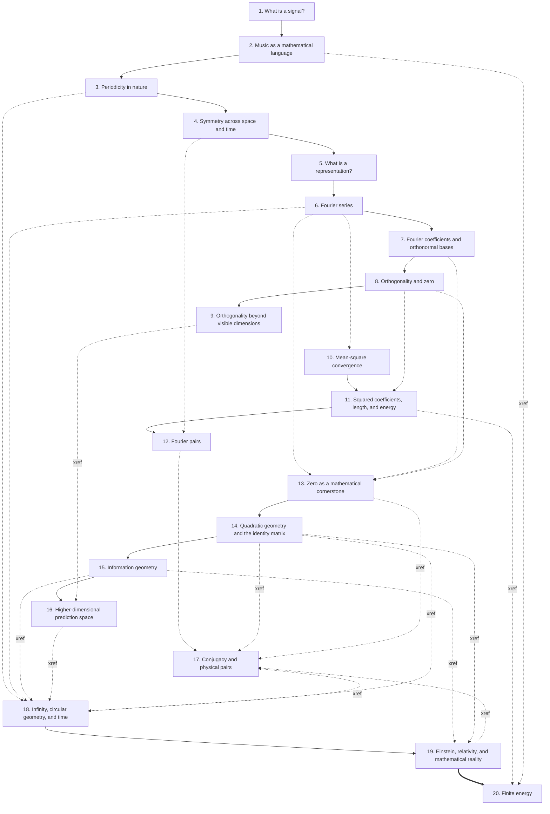

| Edge | Type | Why |
|---|---|---|
| M1 → M2 | NEXT QUESTION | the function on screen raises what belongs to the physical thing and what to its representation |
| M2 → M3 | NEXT QUESTION | with the meaning of the function settled by measurement, its own structure (the repeating pattern) is examined |
| M3 → M4 | NEXT QUESTION | "After discovering periodicity: What remains unchanged when the pattern shifts?" (MM) |
| M4 → M5 | NEXT QUESTION | "After discovering symmetry: Could the same pattern have another representation?" (MM) |
| M5 → M6 | NEXT QUESTION | "This prepares the visitor for Fourier analysis." (MM) |
| M6 → M7 | NEXT QUESTION | "After Fourier reconstruction: Why can these components be separated?" (MM) |
| M7 → M8 | NEXT QUESTION | f̂(k) = 0 with f ≠ 0: "What relation vanished?" — orthogonality answers it |
| M8 → M9 | NEXT QUESTION | "After orthogonality: What does perpendicular mean beyond three dimensions?" (MM) |
| M9 → M10 | OPEN / NO DIRECT CAUSAL EDGE | #10 returns to the Fourier reconstruction (#6) and to Gate 2 answer 2, not to #9 |
| M10 → M11 | NEXT QUESTION | the mean-square measure is the squared L² norm: "Where did the magnitude go?" |
| M11 → M12 | NEXT QUESTION | "If mathematical energy is preserved, what other information distinguishes two representations?" (MM #12) |
| M12 → M13 | OPEN / NO DIRECT CAUSAL EDGE | Stage III shifts "to the rules by which mathematical objects are measured" (MM); #13 gathers zeros met at #6, #7, #8 |
| M13 → M14 | NEXT QUESTION | "your earlier questions about the relationship between the origin, norm, squared norm, zero, and the identity matrix" (MM #14) |
| M14 → M15 | NEXT QUESTION | If distance and magnitude depend on the geometry, how should distance be understood when the valid predictions form a model/prediction manifold? |
| M15 → M16 | NEXT QUESTION | more measured outputs give each prediction more coordinates: what exists beyond the visible model? |
| M16 → M17 | OPEN / NO DIRECT CAUSAL EDGE | no relation in the record makes the conjugacy question follow from prediction space; it comes from #12 |
| M17 → M18 | OPEN / NO DIRECT CAUSAL EDGE | the time question comes from the rotating point (#3, #6) and, as a cross-reference, from #15 / #16 |
| M18 → M19 | NEXT QUESTION | "After your time investigation: Do these relationships tell us something about nature, or only about our mathematical descriptions of it?" (MM) |
| M19 → M20 | APPLICATION HANDOFF | "After the philosophical exploration: Can these mathematical ideas improve how we model finite physical resources?" (MM) |
| M6 → M10 | EARLIER PREDECESSOR | #10 "Return[s] to the Fourier reconstruction" (MM) |
| M8 → M11 | EARLIER PREDECESSOR | orthogonal decomposition removes cross terms, which gives ‖x‖² = Σ\|a_k\|² and Parseval |
| M6 → M13 | EARLIER PREDECESSOR | the zero-frequency component of the Fourier series is one of the zeros #13 compares |
| M7 → M13 | EARLIER PREDECESSOR | the zero coefficient is one of the zeros #13 compares |
| M8 → M13 | EARLIER PREDECESSOR | the zero inner product is one of the zeros #13 compares |
| M4 → M12 | EARLIER PREDECESSOR | a shift in time becomes a phase (R4); the translation chain T1–T5 ("Explain Translation Invariance") |
| M12 → M17 | EARLIER PREDECESSOR | #17 "Begin[s] with a complex Fourier coefficient and its conjugate" (MM): the physical-pair question starts from the conjugate pairs of #12 |
| M3 → M18 | EARLIER PREDECESSOR | "Its periodic behavior motivates your questions about infinite time and finite geometry." (MM, the journey of one signal) |
| M6 → M18 | EARLIER PREDECESSOR | the rotating point of #6 is the circle of #18 ("Begin with the familiar rotating circle", MM #18) |
| M15 → M18 | CROSS-REFERENCE | "After information geometry: Could a similar geometric representation help describe time?" (MM): an earlier mathematical-space question reused when thinking about time |
| M16 → M18 | CROSS-REFERENCE | "A separate mode could explore the idea of events represented together in four-dimensional spacetime, connecting back to your earlier questions about distance, time, and prediction space without treating them as identical structures." (MM #18) |
| M15 → M19 | CROSS-REFERENCE | c → ∞ read as a parameter limit in a family of theories: "The idea came from the model-manifold discussion" (G2 3). Not causal; model manifold ≠ spacetime (G2 4) |
| M9 → M16 | CROSS-REFERENCE | "Geometry is not limited to physically visible dimensions" (MM #9) reused for prediction space |
| M14 → M18 | CROSS-REFERENCE | later mathematical connection (Act VIII, supporting): rotation is a one-parameter group preserving I (CF4, S4) |
| M14 → M19 | CROSS-REFERENCE | later mathematical connection (Act VIII, supporting): the boost is a one-parameter group preserving η (CF4, L1) |
| M11 → M20 | CROSS-REFERENCE | the application compares "mathematical squared norm with physical energy consumption" (MM #20), reusing #11's distinction |
| M2 → M20 | CROSS-REFERENCE | the power-demand signal reuses #2's "what if the signal measured electrical power instead of sound?" |
| M14 → M17 | CROSS-REFERENCE | later mathematical connection (#17 first construction, 2026-11-17): mass selects a level of the Lorentzian form in spectral variables; it labels the orbit as r labels circles (P17Di, P17Lg) |
| M19 → M17 | CROSS-REFERENCE | later mathematical connection (#17, scoped at the lock): boosts act on (ω/c, k) as on (ct, x); proper orthochronous boosts preserve each mass-shell branch; Doppler on the null cone; tanh φ = ck/ω brings a positive-energy mode to rest (P17De, P17Dh, P17La) |
| M18 → M17 | CROSS-REFERENCE | later mathematical connection (#17, scoped at the lock): along the worldline of the same on-shell momentum the phase e^(−i(mc²/ħ)τ) is a character of an unbounded parameter in the bounded circle, as in #18 (P17Lb, A8Fa) — a phase rate, not a Fourier-conjugate pairing |
| M13 → M17 | CROSS-REFERENCE | later mathematical connection (#17 first construction): spectral null, spacetime null, Fourier zero coefficient and model-manifold null kept apart; the zero index P = 0 lies on the massless cone only (P17Dd, P17Cc) |

## C. Non-adjacent historical dependencies (EARLIER PREDECESSOR)

- M6 → M10: #10 "Return[s] to the Fourier reconstruction" (MM)
- M8 → M11: orthogonal decomposition removes cross terms, which gives ‖x‖² = Σ|a_k|² and Parseval
- M6 → M13: the zero-frequency component of the Fourier series is one of the zeros #13 compares
- M7 → M13: the zero coefficient is one of the zeros #13 compares
- M8 → M13: the zero inner product is one of the zeros #13 compares
- M4 → M12: a shift in time becomes a phase (R4); the translation chain T1–T5 ("Explain Translation Invariance")
- M12 → M17: #17 "Begin[s] with a complex Fourier coefficient and its conjugate" (MM): the physical-pair question starts from the conjugate pairs of #12
- M3 → M18: "Its periodic behavior motivates your questions about infinite time and finite geometry." (MM, the journey of one signal)
- M6 → M18: the rotating point of #6 is the circle of #18 ("Begin with the familiar rotating circle", MM #18)

## D. Cross-references that must NOT be treated as causal

- M15 ⇢ M18: "After information geometry: Could a similar geometric representation help describe time?" (MM): an earlier mathematical-space question reused when thinking about time
- M16 ⇢ M18: "A separate mode could explore the idea of events represented together in four-dimensional spacetime, connecting back to your earlier questions about distance, time, and prediction space without treating them as identical structures." (MM #18)
- M15 ⇢ M19: c → ∞ read as a parameter limit in a family of theories: "The idea came from the model-manifold discussion" (G2 3). Not causal; model manifold ≠ spacetime (G2 4)
- M9 ⇢ M16: "Geometry is not limited to physically visible dimensions" (MM #9) reused for prediction space
- M14 ⇢ M18: later mathematical connection (Act VIII, supporting): rotation is a one-parameter group preserving I (CF4, S4)
- M14 ⇢ M19: later mathematical connection (Act VIII, supporting): the boost is a one-parameter group preserving η (CF4, L1)
- M11 ⇢ M20: the application compares "mathematical squared norm with physical energy consumption" (MM #20), reusing #11's distinction
- M2 ⇢ M20: the power-demand signal reuses #2's "what if the signal measured electrical power instead of sound?"
- M14 ⇢ M17: later mathematical connection (#17 first construction, 2026-11-17): mass selects a level of the Lorentzian form in spectral variables; it labels the orbit as r labels circles (P17Di, P17Lg)
- M19 ⇢ M17: later mathematical connection (#17, scoped at the lock): boosts act on (ω/c, k) as on (ct, x); proper orthochronous boosts preserve each mass-shell branch; Doppler on the null cone; tanh φ = ck/ω brings a positive-energy mode to rest (P17De, P17Dh, P17La)
- M18 ⇢ M17: later mathematical connection (#17, scoped at the lock): along the worldline of the same on-shell momentum the phase e^(−i(mc²/ħ)τ) is a character of an unbounded parameter in the bounded circle, as in #18 (P17Lb, A8Fa) — a phase rate, not a Fourier-conjugate pairing
- M13 ⇢ M17: later mathematical connection (#17 first construction): spectral null, spacetime null, Fourier zero coefficient and model-manifold null kept apart; the zero index P = 0 lies on the massless cone only (P17Dd, P17Cc)

In particular: prediction / model space (#15, #16) ⇢ time and spacetime (#18, #19) means an earlier mathematical-space question was later reused when thinking about time/spacetime. It does NOT mean model manifolds and spacetime are the same structure, and it does NOT mean model-manifold theory generated relativity historically. The historical route to relativity is #18 → #19.

## Relation chains

Q = a question node; R = the relation that answered or sharpened it. Each Q after the first is the next question created by the R before it. X = a CROSS-REFERENCE to an already-existing question (dotted "xref" arrow): it was not created by the R before it.

### Chain A: Zero, magnitude and quadratic measurement (#13 → #14)

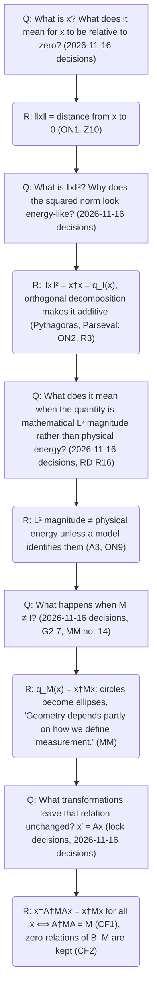

### Chain F: Fourier, question-driven (#3 → #12)

```mermaid
flowchart TD
  F0["Q: What remains unchanged when the pattern shifts? (MM, after no. 3)"]
  F1("R: a repeating pattern survives translation (T1)")
  F0 --> F1
  F2["Q: Could the same pattern have another representation? (MM, after no. 4)"]
  F1 --> F2
  F3("R: f = Σ c_k e_k: a sum of rotating points (no. 6, R1, R6)")
  F2 --> F3
  F4["Q: Why can these components be separated? (MM, after no. 6)"]
  F3 --> F4
  F5("R: f̂(k) = ⟨f, e_k⟩: each coefficient records the relation to a mode (CP §1b, R2)")
  F4 --> F5
  F6["Q: f̂(k) = 0 while f ≠ 0: What relation vanished? (lock decisions)"]
  F5 --> F6
  F7("R: f ⊥ e_k (Z7), ⟨e_j, e_k⟩ = δ_jk (R1): orthogonality answers it")
  F6 --> F7
  F8["Q: What does perpendicular mean beyond three dimensions? (MM, after no. 8)"]
  F7 --> F8
  F9("R: inner products in ℝⁿ and L², orthogonal decomposition removes cross terms (ON2, ON3)")
  F8 --> F9
  F10["Q: What does mathematical energy actually measure? (MM, after no. 11)"]
  F9 --> F10
  F11("R: ‖f‖² = Σ‖f̂(k)‖² (Parseval, R3): energy-like, not physical energy (A3)")
  F10 --> F11
  F12["Q: If mathematical energy is preserved, what other information distinguishes two representations? (MM, no. 12)"]
  F11 --> F12
  F13("R: phase: ‖x̂‖ does not determine x (T-MAGPHASE, B5a FAIL kept)")
  F12 --> F13
```

### Chain Z: Zero stays relational (#13 and the later zero research)

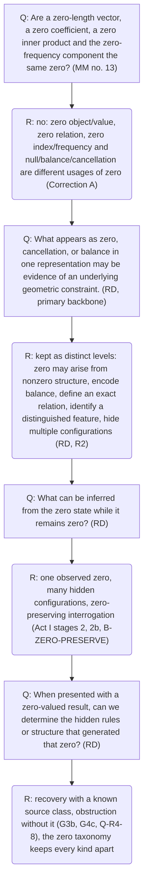

### Chain PA: Pair A: transfer the question, not the objects

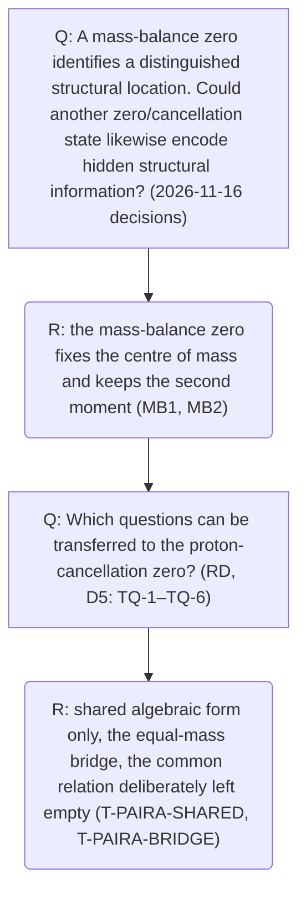

### Chain PB: Pair B and ★: geometry, rules and repeated behaviour (#3, #4, #18)

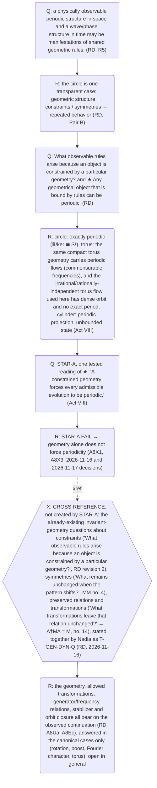

### Chain IG: Why model manifolds entered (#14 → #15 → #16)

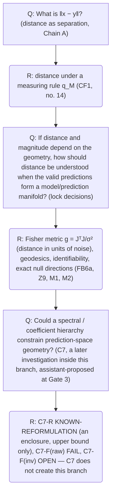

### Chain PS: Possibility space → allowable space → manifestation (#16)

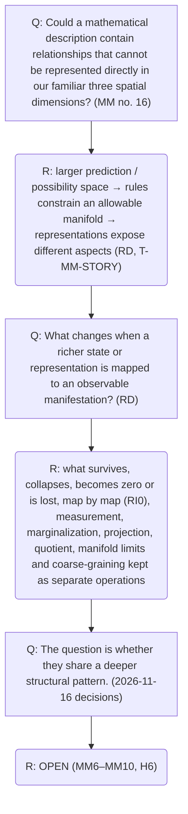

### Chain TC: Circle, time, then relativity and c (#18 → #19)

```mermaid
flowchart TD
  TC0["Q: Adding an infinite object like time to a finite circle geometry makes sines and cosines converge to infinity. (MM no. 18, historical, FAIL, kept)"]
  TC1("R: −1 ≤ sin t, cos t ≤ 1 (G2 6), ‖e^(iωt)‖ = 1, no limit (C8a, A8Cc)")
  TC0 --> TC1
  TC2["Q: an unbounded parameter → bounded geometry → indefinitely repeated structure: does it have deeper mathematical analogues elsewhere? (G2 8)"]
  TC1 --> TC2
  TC3("R: The corrected relation is that an unbounded parameter can produce indefinitely continuing evolution while an observable representation remains bounded. χ_ω is the translation character, ℝ/ker χ_ω ≅ S¹ (A8Fa), torus and cylinder refine what geometry alone implies (Act VIII)")
  TC2 --> TC3
  TC4["Q: Do these relationships tell us something about nature, or only about our mathematical descriptions of it? (MM, after no. 18)"]
  TC3 --> TC4
  TC5("R: relativity: observers change, ΛᵀηΛ = η stays (L1), the observer-change parameter is the rapidity, tanh φ = v/c (A8Eb, A8Wa), the circle comparison is θ ↔ φ, not t ↔ c")
  TC4 --> TC5
  TC6["Q: In 'the speed of light … converges to infinity,' what is going to infinity? (G2 3)"]
  TC5 --> TC6
  TC7("R: c → ∞ is a family limit: M_c → diag(1, 0), Lorentz → Galilean at fixed v (not at fixed v/c), a contraction (L3, A8Mc, A8Lb, A8Lc, A8X5), c's finite-geometry roles stay distinct (A8Wc)")
  TC6 --> TC7
  TC8["Q: That transition between the two roles is what interests me. (T-C-ROLES)"]
  TC7 --> TC8
  TC9("R: OPEN (H3-1). Restricted: the bare congruence class of M_c does not distinguish finite values of c (A8Wc), the velocity-parametrized boost generator K_c has det K_c = −1/c² and contracts to the Galilean shear (C9c)")
  TC8 --> TC9
```

### Chain E: Energy stays downstream (#2, #11 → #20)

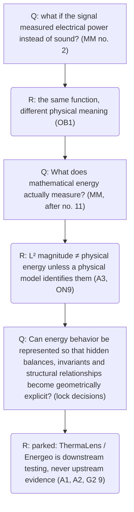

### Chain P17: Conjugacy and physical pairs (#12 → #17; first construction and lock, 2026-11-17)

```mermaid
flowchart TD
  P170["Q: If mathematical energy is preserved, what other information distinguishes two representations? (MM no. 12)"]
  P171("R: Fourier conjugacy: for a real signal the coefficients come in conjugate pairs, exactly, x ∈ L¹: x̂(−ω) = conj x̂(ω) ⟺ x real a.e., each pair is one real oscillation (P1, P17Fa, P17Fh, P17Lc–P17Le)")
  P170 --> P171
  P172["Q: Do observable physical pairings or complementarities reflect deeper symmetry analogous to mathematical conjugacy? (RD, MM no. 17 — not assumed)"]
  P171 --> P172
  P173("R: first physical candidate, a real classical field: φ̃(−ω, −k) = conj φ̃(ω, k) — the same theorem, a reality constraint, not two entities, sign symmetry, orbit symmetry, independent states and notation-dependent pairs are other kinds (P17Rc, P17Cd, P17K)")
  P172 --> P173
  P174{{"X: CROSS-REFERENCE to the seed (recorded 2026-11-12, kept verbatim, not promoted): 'mass is waves too, it's just a different form.' — the candidate mass/wave investigation inside no. 17, the dispersion relation, read in spectral variables, reuses the Lorentzian form of no. 14 / no. 19 (cross-references)"}}
  P173 -. xref .-> P174
  P175("R: exact mass-shell relation: mass selects the invariant level of one Lorentzian form — m = 0 ⇒ q(P) = 0 (null level), m > 0 ⇒ q(P) = (mc/ħ)² > 0 (a nonzero timelike level), proper orthochronous boosts preserve each branch (P17Lg, P17La, P17De)")
  P174 --> P175
  P176["Q: MW-C: 'Mass and wave variables form a conjugate pair in the same mathematical sense as Fourier conjugates.' (2026-11-17 decisions)"]
  P175 --> P176
  P177("R: FAIL: conjugation maps each mass shell to itself, what survives is that mass determines the level and the proper-time phase rate mc²/ħ along the worldline of the same on-shell momentum — a phase rate, not a Fourier-conjugate pairing (P17Ch, P17Lb, P17Lf)")
  P176 --> P177
  P178["Q: Is there a physically meaningful formulation in which mass/rest energy acts as a genuine spectral variable conjugate to proper time? (Q17-4), and MW-D, Q17-1, Q17-2 (OPEN, not begun)"]
  P177 --> P178
```

### Chain T: Translation invariance (#3 / #4 → #12 → #18)

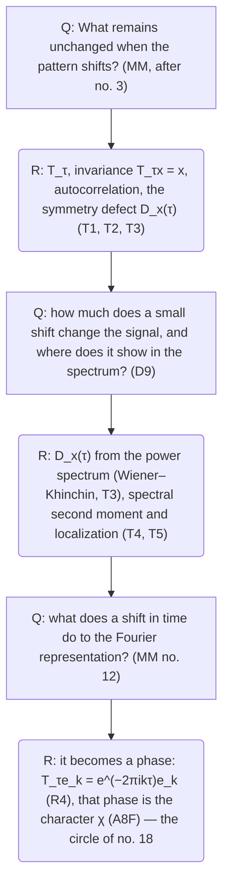

## E. Act VIII final placement

Categories: A = ANSWERS AN EXISTING QUESTION; B = CONNECTS TWO EXISTING QUESTIONS; C = SUPPORTING MATHEMATICS; D = OPTIONAL RESEARCH BRANCH; E = CONTRADICTS / REFINES AN OLD CONJECTURE. Supporting mathematics is not a canonical story node unless it answers a historical Nadia question.

| Result | Objects | Category | Placement | Historical question it serves | Note |
|---|---|---|---|---|---|
| circle: ‖e^(iωt)‖ bounded, period 2π/\|ω\|, no limit, ℝ/Tℤ ≅ S¹, covering | A8C | A | #18 answer | #18: G2 6 and 8 (unbounded t, bounded S¹) | answers the question as Nadia restated it |
| distinction table (parameter, lift, cycles, bounded, convergence, recurrence, periodicity, density, drift) | A8D | A | #18 answer | #18: "compare what happens to elapsed time, number of revolutions, sine and cosine values, cumulative quantities, and mathematical limits" (MM); G2 6 "two very different kinds of infinity" | answers |
| torus: commensurability — the same torus geometry also carries periodic flows; the irrational/rationally-independent torus flow used here has dense orbit and no exact period; kernel vs orbit closure | A8T, A8KC | A | #18 answer | #18 (G2 8: "deeper analogues"); #3 ("try a nonperiodic sound") | answers; refines ★ (STAR-A) |
| exact versus near recurrence | A8Tc, A8Pc | A | #18 answer | #18: "one revolution, ten revolutions, a thousand" (MM) — exact return vs near return | answers |
| cylinder: periodic projection, unbounded state | A8X2, A8Yb | A | #18 answer | #18: "extend the picture into a cylindrical geometry" (MM) | answers |
| rapidity: tanh φ = v/c; θ ↔ φ | A8Eb, A8Wa | A | #19 answer | #19: which transformations change the observer (MM) | answers; also refines the literal t ↔ c reading (E) |
| roles of c: finite-c forms M_c, null cone, restricted content of c | A8M, A8Wc | A | #19 answer | #19 and G2 3 (what goes to infinity) | answers |
| c → ∞: degenerate form, Galilean boosts at fixed v, contraction | A8L | A | #19 answer | #19 and G2 3; the model-family reading of c → ∞ is a cross-reference from #15 / #16 (Correction B), not its cause | answers |
| Fourier character χ_ω | A8F | B | connector backward | #4 (translation) and #12 (a shift becomes a phase, R4) → #18 (the circle) | connects existing nodes R4 and R6; no new theorem |
| SO(2) / SO(1,1) | A8E | B | connector backward | #14 (preserved forms I, η) ⇢ #18 (rotation) and #19 (boost): a cross-reference | connects; re-cards the existing trichotomy (S4, B1b, B1c), adding only the 3D scope check |
| boundary approach ≅ drift | A8Pg | B | connector backward | C8 (wrapping / near return / boundary approach, Gate 3) and S5b (tanh bound) → #18 | connects |
| generator theorem KᵀM + MK = 0 ⟺ e^(sK) preserves M | A8G | C | supporting only | #14 ⇢ #18 / #19 | supporting: the theorem is the existing CF4 (BR11), re-carded; only the step to orbit behaviour (BR81) is new. It explains part of #18 and does not replace it |
| stabilizer / orbit terminology | A8A | C | supporting only | #3, #18 (periodicity is a nontrivial stabilizer) | supporting machinery |
| elliptic / parabolic / hyperbolic language | A8Ec | C | supporting only | Part VII "Trichotomy: rotation / boost / shear by the sign of the invariant" (S4) | pre-existing vocabulary |
| H3 candidate formalizations (H3-action, H3-quotient) | A8HA, A8HQ | C | supporting only | H3 (CP §1a) at #18 | formalizations; H3-original stays open |
| κ-family M_κ | A8Q | D | optional (parked) | none required (section E) | optional later construction |
| ★ readings STAR-A/B/C; STAR-A lesson | A8SA–A8SC, A8GD | E | refinement / failure | Pair B / ★ (RD) at #3, #4, #18 | refines the ★ question; ★ kept verbatim and open |
| old wording "sines and cosines converge to infinity" | A8Cc | E | refinement / failure | #18 (MM) | FAIL, kept as the historical conjecture T-TIME-CIRCLE-0 |
| literal t ↔ c (H3-c-direct) | A8HCD | E | refinement / failure | H3 c-clause (CP §1a) at #19 | FAIL / superficial; the H3-c split keeps group (B) and family (A) apart |
| counterexamples X1–X6 and rejected implications | A8X | E | refinement / failure | #18, ★, G2 2 (X6), G2 3 (X5: scaling) | each refines a question |
| T-GEN-DYN-Q | A8G | E | refinement / failure | the already-existing invariant-geometry questions (T-GEOM-RULES, #4, #14), stated together; cross-referenced from STAR-A's failure, not created by it (pre-#17 patch, 2026-11-17) | a refinement of the original question; STAR-A's failure did not historically cause it |

## F. Optional material: the κ-family

**Verdict: PARK AS OPTIONAL (supporting note).**

- What pre-existing Nadia question does M_κ answer? None directly. Gate 2 answer 3 asks what goes to infinity for c (answered by A8M, A8L); Gate 2 answer 8 asks whether "an unbounded quantity expressed through a bounded geometry" has deeper analogues (answered by A8F, A8T, A8X2). Neither asks for a common family of the circle frequency and c.
- It touches #14 (forms), #18 (circle) and #19 (c), but the #18–#19 connection the story needs is already supplied by the historical NEXT QUESTION edge and, mathematically, by the rotation/boost comparison (A8E) and the rapidity correction (A8Wa).
- It is a later synthesis by Claude (2026-11-16): its circle is the harmonic oscillator in (p, q), not the Fourier circle of #6 / #18, and its shared limit (ω → 0, c → ∞) depends on the scaling held fixed (A8Qb, A8X5).
- Kept on the ledger (A8Qa, A8Qb) and in the record as an optional later construction; not a story node, not a bridge the story uses; no further κ-research. Live statements outside its parked notes no longer cite it (lock pass).

## G. Failed conjectures: what each taught, and the question it produced

| Failure | Historical question | What it taught | Next question |
|---|---|---|---|
| "Adding an infinite object like time to a finite circle geometry makes sines and cosines converge to infinity." (T-TIME-CIRCLE-0) | #18 (MM) | sin and cos stay in [−1, 1] and have no limit; what is unbounded is t, the lift ωt and the cycle count (A8Ca, A8Cc, A8Cd) | an unbounded quantity expressed through a bounded geometry: does it have deeper mathematical analogues elsewhere? (G2 8) |
| STAR-A: "A constrained geometry forces every admissible evolution to be periodic." | ★ / Pair B (#3, #4, #18) | geometry alone does not force periodicity: the irrational/rationally-independent torus flow has dense orbit and no exact period, although the same torus carries periodic flows; the logistic flow on [0, 1] has no non-constant periodic orbit (A8X1, A8X3, A8Ua) | none created (pre-#17 patch, 2026-11-17): CROSS-REFERENCE ⇢ the already-existing invariant-geometry questions — constraints (T-GEOM-RULES), symmetries (#4), preserved relations and transformations (#14, A†MA = M), stated together as T-GEN-DYN-Q |
| literal t ↔ c (H3-c-direct) | H3 c-clause at #19 | t is an action parameter (θ = ωt); the Lorentz group parameter is the rapidity φ; c is a form / unit constant (A8Sa, A8Wa) | the two roles of c (H3-1, open) |
| "circle radius r ↔ c" (Claude's pass-1 analogy) | #18 / #19 comparison | r is an orbit invariant, c a form parameter; the counterpart of r² is q_c on the orbit (A8Wb) | none: discarded |
| "the invariant content of c is whether it is finite" (Claude's, superseded) | #19, H3-1 | the congruence class of the bare form M_c does not see finite values of c; c's physical roles (causal structure, v/c, family limit) are kept (A8Wc) | H3-1 stays open |
| compact ⇒ periodic; bounded ⇒ convergent; unbounded parameter ⇒ unbounded observable; parameter → ∞ ⇒ dimension loss | #18, #19 | each property is separate (distinction table A8D; A8Ra–A8Rd); a limit has content only once what is held fixed is stated (A8X5) | which object decides the behaviour: stabilizer, orbit closure, scaling |
| one quotient statement for periodic and dense orbits (H3-quotient as first worded) | #18 | periodic case: kernel / quotient; dense case: orbit closure / subtorus (A8Ka, A8Kb) | none further: restricted |
| "#15 → #19" as a causal edge (Claude's 2026-11-16 diagnostic) | #18 → #19 | the model-family reading of c → ∞ is a later cross-reference; model manifolds and spacetime are different structures (Correction B; G2 4) | none: corrected |
| zero frequency listed with zero-valued relations (Claude's 2026-11-16 diagnostic) | #13 | k = 0 is a zero in the index / coordinate domain (Correction A) | none: corrected |
| MW-C: "Mass and wave variables form a conjugate pair in the same mathematical sense as Fourier conjugates." | #17 (mass/wave seed) | complex conjugation maps each mass shell to itself; mass determines the invariant mass-shell level and the associated rest-frame / proper-time phase rate, which is not a pairing (P17Ch, P17Lf) | Is there a physically meaningful formulation in which mass/rest energy acts as a genuine spectral variable conjugate to proper time? (OPEN, not investigated) |
| "mc²/ħ and proper time are a Fourier-dual pair" (Claude's #17 construction pass) | #17 | a phase rate set by a parameter does not make the parameter Fourier-conjugate to time: the elastic-foundation string has the same structure (P17Lf) | none: withdrawn at the #17 lock |
| "boosts move points along a branch but never between branches" and "m changes the shape" (Claude's #17 report wording) | #17 | proper orthochronous boosts preserve each branch, the full Lorentz group does not (P17La); m selects the level of one unchanged form (P17Lg) | none: corrected |

## Mathematical lock (no new theorems)

| Live statement | Cards | Assumptions / scaling | Status |
|---|---|---|---|
| unbounded t with a bounded circle image | A8Ca, A8Cd, C8a | none | LOCKED |
| exact periodicity of e^(iωt): minimal period 2π/\|ω\|; Stab = (2π/\|ω\|)ℤ; ℝ/Tℤ ≅ S¹ | A8Cb, A8Ce, A8Cf, A8Fa | ω ≠ 0 | LOCKED |
| irrational torus flow: compact orbit closure, Stab = {0} (aperiodic), dense, near-recurrent, image not closed | A8Tb, A8Tc, A8X1, A8Kb | frequencies rationally independent; density is the Kronecker–Weyl theorem (source-locked); the same torus geometry carries periodic flows when the frequencies are commensurable (A8Ta, A8Ua) | LOCKED |
| cylinder: periodic projection, nonperiodic and noncompact full state | A8X2, A8Yb | v ≠ 0 | LOCKED |
| the rapidity, not c, is the Lorentz group parameter | A8Eb, A8Wa, S5a | tanh φ = v/c, \|v\| < c | LOCKED |
| c has distinct roles: finite-c forms (congruent by rescaling; null cone x = ±ct) and the theory-family limit c → ∞ | A8Ma, A8Md, A8Wc, A8Mc | the congruence statement concerns the bare form only; it does not remove c's physical role | LOCKED |
| c → ∞: M_c → diag(1, 0) (degenerate), Lorentz → Galilean boosts, Poincaré(1+1) → Galilei(1+1) | A8Mc, A8Lb, A8Lc, C9b, C9c | v and x held fixed; with β = v/c fixed nothing contracts (A8X5) | LOCKED |
| STAR-A FAIL | A8X1, A8X3, A8Ra | the question ★ stays OPEN (T-STAR, hypothesis); ★'s Backbone Support restored to 20% (I2) | LOCKED as FAIL |

Live-text audit:

- no live statement makes #15 / #16 a cause of #19: master map Part IX, alignment D12 / D39, the Act VIII placement: cross-reference wording only.
- no live statement uses the parked κ-family as a bridge: A8K, A8HCF, L4, T-C-ROLES, T-H3-C-FAMILY and the Act VIII t-vs-c table cite C9c / A8Lc instead; κ appears only in its parked notes.
- vectors written with ‖x‖, ‖x‖² = x†x: master map Part III Chain A sentence and Part IX; this graph.
- zero frequency kept at #13, in its own category: master map Part IV "Kinds of zero".
- the spine labelled as abstract summary: master map Part I.
- superseded wordings ("r ↔ c", "invariant content is finiteness", "places Act VIII in the spine") absent from live text: checked by test/act8_story.test.js and test/canonical_story.test.js.

## Current-repository alignment (every Foundation domain)

Actions used: KEEP; MOVE; RECLASSIFY; ADD CONNECTIVE SENTENCE; ADD DIAGRAM EDGE; SPLIT; PARK AS OPTIONAL; SUPERSEDE WORDING; DELETE DUPLICATE/ASSISTANT-INVENTED LIVE CLAIM.

| Domain | Canonical predecessor | Relation it contributes | Next question it feeds | Verdict | Actions |
|---|---|---|---|---|---|
| D1 | all (the spine is the abstract summary of M1–M20) | the two-map system | — | correct; the spine is now labelled ABSTRACT STRUCTURAL SUMMARY OF THE CANONICAL STORY | KEEP; ADD CONNECTIVE SENTENCE |
| D2 | method rules (no story node) | statuses, provenance, bridge strengths | — | supporting only | KEEP |
| D3 | M5, M6 | f = Σ f̂(k)e_k; a shift becomes a phase | M7, M8, M12 | correct; story order coefficient → zero → orthogonality stated (Part II) | KEEP; ADD CONNECTIVE SENTENCE |
| D4 | M7 (What relation vanished?) | ⟨e_j, e_k⟩ = δ_jk; projection; Pythagoras | M9, M11 (earlier predecessor) | correct | KEEP |
| D5 | M13, M14 (Chain A) | A†MA = M; zero relations kept; generators; conservation | M15; cross-reference to M18 / M19 | correct; Chain A lead-in stated (Part III) | KEEP; ADD CONNECTIVE SENTENCE |
| D6 | M14 + "relationship ridden" (G2 5) | the common-form hypothesis | cross-system tests | correct | KEEP |
| D28 | M5 ("different objects, or different descriptions?") | covariance / invariance / equivariance | what survives (RI0) | correct | KEEP; ADD DIAGRAM EDGE |
| D29 | D28 (later Nadia question) | — | — | open, correctly placed | KEEP |
| D30 | M12, M16 | what survives a map | possibility → manifestation | correct | KEEP |
| D31 | M12 / Act VI (DYADIC PACKETS, Nadia's term) | — | — | open, correctly placed | KEEP |
| D27 | M14 | coordinate-free F*T = T | — | supporting only | KEEP |
| D7 | M13 | the zero taxonomy; four kinds of zero | Chain Z questions | corrected (Correction A): zero frequency moved out of the zero-value table into the index/frequency category | KEEP; MOVE; ADD CONNECTIVE SENTENCE |
| D8 | Chain Z (RD zero questions) | zero as connector; the inverse problem | Pair A, R4 construction | correct | KEEP |
| D9 | M3, M4 ("What remains unchanged when the pattern shifts?") | translation → correlation → symmetry defect → spectrum | M12 and M18 (earlier-predecessor edges) | correct | KEEP; ADD DIAGRAM EDGE |
| D10 | M18 → M19 | ΛᵀηΛ = η; rapidity; c → ∞ | M20 (handoff), H3-1 | correct | KEEP |
| D11 | M18, M10 | known continuation behaviours | M18 (Act VIII) | correct | KEEP |
| D12 | M14 → M15 | Fisher metric, geodesics, null directions | M16; cross-reference to M18 / M19 (not causal) | corrected (Correction B): no causal edge to relativity | KEEP; SUPERSEDE WORDING |
| D13 | M15 (a later question inside the branch) + M7 / M11 | C7 as first posed | — | correct; C7 does not create the branch | KEEP |
| D34 | D13 | C7-R enclosure | — | correct (locked) | KEEP |
| D35 | D13 | C7 negative results | — | correct (locked) | KEEP |
| D36 | D13 | C7-F(inv) | — | open, correctly placed | KEEP |
| D37 | M18 (G2 6, 8); M3, M6 (earlier predecessors) | circle quotient, torus, cylinder, distinction table, counterexamples | M19; T-GEN-DYN-Q | correct; the historical question leads the section | KEEP |
| D38 | H3, ★ (M18; Pair B) | readings and candidate formalizations | T-GEN-DYN-Q | correct; refinements kept as refinements of the original question | KEEP |
| D40 | M14 ⇢ M18 / M19 (cross-reference) | CF4 re-carded; rotation / boost re-carded; the Fourier character connecting R4 and R6; kernel vs orbit closure; κ-family (parked) | M18, M19 | supporting / connecting mathematics, not a story node; κ parked | KEEP; PARK AS OPTIONAL |
| D39 | M18 → M19 (historical); cross-reference from M15 / M16 (G2 3) | c-indexed forms; Galilean limit at fixed v; t ≠ c | H3-1 | corrected (Correction B): the cross-reference is not causal | KEEP; SUPERSEDE WORDING |
| D32 | M16 | the model-manifold research story | possibility → manifestation (open) | correct | KEEP |
| D33 | M15 | model-manifold invariance | — | supporting only | KEEP |
| D14 | M12 / Act VI (information lost and recovered) | wavelets, modulus, scattering | D15 | correct | KEEP |
| D15 | Act VI | DYADIC PACKETS (open) | — | open, correctly placed | KEEP |
| D16 | M16 | reduced representations (examples) | H6 | correct | KEEP |
| D17 | M9 → Act III | R4 tetrahedral / simplex constructions | Chain Z inverse question | correct | KEEP; ADD DIAGRAM EDGE |
| D18 | Chain Z (Act I stage 2: the proton zero) | quantum same-zero | Pair A | correct | KEEP |
| D19 | Pair A (T-PAIRA-Q) | cross-domain transfer | — | correct | KEEP |
| D20 | M12 → M17 (earlier predecessor) | conjugate pairs; mass-wave ingredients | D41 (#17 first construction) | correct; physical pairs not claimed conjugate | KEEP |
| D41 | M12 → M17 (earlier predecessor); cross-references from M13, M14, M18, M19 | Fourier conjugacy source lock; real-field reality pairing; spectral null and mass-shell levels; kinds of pairing; MW-A–MW-D | Q17-1–Q17-4 (open, not begun) | LOCKED (2026-11-17); no new story node; the cross-references are not causal | KEEP; ADD DIAGRAM EDGE; ADD CONNECTIVE SENTENCE |
| D21 | M17, M18, M19 (user hypotheses) | — | — | open, correctly placed | KEEP |
| D22 | M16 | the effective-representation question | — | open, correctly placed | KEEP |
| D23 | M17, M19 (philosophical lenses) | — | — | open, correctly placed | KEEP |
| D24 | every failed reading | failures and boundaries | the next question each failure forced | correct | KEEP |
| D25 | M19 → M20 (application handoff) | application (downstream) | — | correct | KEEP |
| D26 | M2, M11 ⇢ M20 (cross-references) | physical energy vs L² magnitude | M20 | correct; upstream of Energeo | KEEP |

## Connectors added (2026-11-16, corrected 2026-11-17)

| ID | Between | What | Repair |
|---|---|---|---|
| F1 | M13 → M14 → CF1 | the Chain A path ‖x‖ → ‖x‖² → q_I → q_M → A†MA = M | connective sentence at the top of Part III (added 2026-11-16; notation ‖·‖ fixed 2026-11-17) |
| F2 | M7 → M8 | story order: f̂(k) = ⟨f, e_k⟩ → f̂(k) = 0 with f ≠ 0 → What relation vanished? → orthogonality | connective sentence in Part II (added 2026-11-16) |
| F3 | M14 → M15 | why model manifolds entered: distance under a measuring rule → distance on a model / prediction manifold; C7 is a later question inside the branch | connective sentence in Part IX (added 2026-11-16; cross-reference wording fixed 2026-11-17) |
| F4 | M3 / M4 → D9 → M12 → M18 | the translation chain's predecessor and successor | earlier-predecessor edges (this graph) and one sentence in Part VII |
| F5 | M12 → M17 | the physical-pair question comes from the conjugate coefficient pairs | earlier-predecessor edge |
| F6 | M15 / M16 ⇢ M18 / M19 | the model-family reading of c → ∞ and the time question reuse the mathematical-space idea | cross-reference edges (Correction B; replaces the 2026-11-16 causal edge M15 → M19) |
| F7 | M13 → Part IV | zero frequency is a zero index / coordinate, not a zero value | the "Kinds of zero" table in Part IV (Correction A; replaces the 2026-11-16 row in the zero-value table) |
| F8 | Pair A | the question that created Pair A | registry record T-PAIRA-Q (added 2026-11-16) |
| F9 | M2 / M11 ⇢ M20 | the energy question's predecessors | connective sentence in Part XIV (added 2026-11-16) |
| F10 | Pair B / ★ → T-GEN-DYN-Q | the Act VIII results read as a refinement of the original question, with the original question first | connective sentence leading the Act VIII section (added 2026-11-16) |
| F11 | STAR-A ⇢ invariant-geometry questions | STAR-A failure → geometry alone does not force periodicity, followed by a CROSS-REFERENCE to the already-existing questions about constraints, symmetries, preserved relations and transformations (T-GEOM-RULES, #4, #14, T-GEN-DYN-Q); not a causal edge | chain PB, failures table, Act VIII placement row, registry T-GEN-DYN-Q, master map Part VII (pre-#17 patch, 2026-11-17) |

## Superseded statements of the 2026-11-16 diagnostic (kept)

| Where | Old | Why |
|---|---|---|
| 2026-11-16 diagnostic, edge list | M15 → M19 as an earlier-predecessor edge: "c → ∞ entered from the model-manifold discussion" | Correction B: a cross-reference, not a causal edge |
| 2026-11-16 diagnostic, edge list | M15 → M18 as an earlier-predecessor edge | Correction B: the Master Map's "Could a similar geometric representation help describe time?" reuses an earlier idea; recorded as a cross-reference |
| 2026-11-16 diagnostic, continuity | every numbered transition graded "yes", "partly" or "no — repaired by an edge" | Correction C: a numbered adjacency is not automatically a NEXT QUESTION edge; four pairs are OPEN / NO DIRECT CAUSAL EDGE |
| master map Part IV (2026-11-16) | "\| Zero frequency (k = 0, ω = 0; Master Map #13) \| e₀ = 1; χ₀(t) = 1 \| signals \| the index of a mode is zero …" as a row of the zero-value taxonomy table | Correction A: moved to the zero index / frequency category |
| 2026-11-16 diagnostic, Chain A | \|x\|, \|x\|² for a general vector | notation: ‖x‖, ‖x‖² = x†x |
| 2026-11-16 diagnostic, lock choice | READY FOR ACT VIII ADVERSARIAL LOCK AFTER STORY ALIGNMENT | superseded by the final lock verdict of 2026-11-17 |
| #17 first construction, chain P17 | order: … real field → X (#14, #19) → mass-shell levels → X seed → MW readings → open questions; R "MW-C FAIL as conjugacy, with mc²/ħ Fourier-dual to proper time" | #17 lock: the decided order (Fourier conjugacy → physical pairings → candidate mass/wave investigation → exact mass-shell relation → failed conjugacy interpretation → more precise open question); the Fourier-duality claim withdrawn |
| 2026-11-17 lock, node M17 (next question) | mass-like and wave-like descriptions (R4, R18; MW1) — the parked mass-wave branch; no direct causal successor at #18 | #17 first construction: the branch is not defined as mass-wave; mass/wave is one candidate investigation inside it |
| 2026-11-17 lock, Act VIII placement and chain PB | "torus: commensurability; dense irrational flow, never periodic" and "torus: compact, possibly never periodic" | pre-#17 patch: scoped — the irrational/rationally-independent torus flow used here has dense orbit and no exact period; the same torus geometry also carries periodic flows |
| 2026-11-16 diagnostic and 2026-11-17 lock, chain PB, failures table, Act VIII placement | T-GEN-DYN-Q "created by STAR-A's failure", "the next question of the ★ chain"; STAR-A's next question = T-GEN-DYN-Q; chain PB step "geometry alone does not force exact periodicity — so what else bears on the continuation?" as a question created by STAR-A | pre-#17 patch: STAR-A's failure did not historically cause the invariant-form / generator question; it is recorded as a lesson followed by a CROSS-REFERENCE |

## H–I. Verdicts

**LOCK ACT VIII — STORY AND MATHEMATICS ALIGNED**

Every live Act VIII statement answers or refines #18 or #19, connects backward to #4 / #12 / #14 as a labelled connector or cross-reference, or is supporting / optional and labelled so; the three story corrections are applied; the eight required mathematical statements are carded with their assumptions; the failed conjectures are kept with what they taught. The story table uses typed edges, and no adjacency is treated as causal without a relation in the record.

Limits: The four named conversations could not be opened; the Chain A questions rest on Nadia's 2026-11-16 recollection. H3-original and H3-1 stay OPEN; they are open research questions, not misplacements.

Next canonical unresolved question at the lock (not begun then): #17 — "Do observable physical pairings or complementarities reflect deeper symmetry analogous to mathematical conjugacy?" (T-CONJUGACY). It is the earliest canonical node with no answering construction yet; it arises from #12 (conjugate coefficient pairs give a real signal) and leads to the parked mass-wave branch (T-MASS-WAVE-SEED). #20 stays a parked downstream application. Not begun.

## #17: first construction and lock (2026-11-17)

First construction of #17 (2026-11-17): no new story node; the historical edge stays #12 → #17; #13, #14, #18 and #19 ⇢ #17 are cross-references (later mathematical connections). Statuses are separate: Fourier conjugacy ESTABLISHED; real-field ± mode relation DERIVED; massless null relation ESTABLISHED; mass-shell level set DERIVED; E = ħω, p = ħk RESTRICTED; MW-A RESTRICTED; MW-B ESTABLISHED; MW-C FAIL; MW-D OPEN; the broader #17 hypothesis OPEN.

Record: `research/constructions/p17_conjugacy_physical_pairs.md`. Construction-pass recommendation: READY FOR #17 ADVERSARIAL LOCK.

**LOCK #17 — STORY AND MATHEMATICS ALIGNED**

#17 final adversarial lock (2026-11-17): boost scope (proper orthochronous boosts preserve each branch; not the full Lorentz group); mass selects the invariant level (m = 0 ⇒ q(P) = 0; m > 0 ⇒ q(P) = (mc/ħ)² > 0); the proper-time phase rate scoped to the worldline of the same on-shell momentum; the Fourier-duality claim withdrawn (Q17-4 OPEN, not investigated); the Fourier converse source-locked (Zhou–Siadat Th. 1.15, read) and carded exactly for finite signals and finite Hermite expansions. Story order: Fourier conjugacy → question about physical pairings → candidate mass/wave investigation → exact mass-shell relation → failed conjugacy interpretation → more precise open question.

Research is paused after the #17 lock. No subsequent branch has been started. The preview represents the current canonical state of the project.
